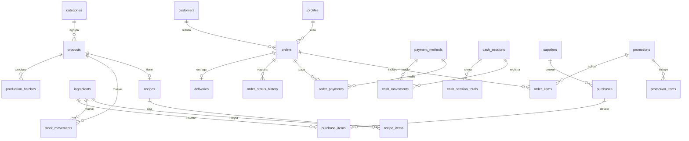

# Doña Gorriti — Arquitectura de datos y sistema

> Propuesta v1 · 6 de noviembre de 2026 · para aprobar antes de escribir código.

## 0. Resumen

Sistema de gestión gastronómica multi-usuario, responsive, con seis fases de producto.
La base es **Next.js 16 (App Router) + Supabase (Postgres, Auth, Storage, RLS)**.
Toda operación que mueve plata o stock se resuelve en **una función transaccional de
Postgres**; el cliente nunca calcula precios ni totales.

Regla de oro: **el pedido es el hecho central**. Confirmar un pedido impacta pedidos,
stock, caja, métricas, historial del cliente y auditoría en la misma transacción.

---

## 1. Stack y decisiones técnicas

| Área          | Elección                                                             | Motivo                                                                                    |
| ------------- | -------------------------------------------------------------------- | ----------------------------------------------------------------------------------------- |
| Framework     | Next.js 16.4 (App Router, React 19.3, TypeScript)                    | Server Components para listados, Server Actions para mutaciones, deploy simple en Vercel. |
| Auth y sesión | Supabase Auth + `@supabase/ssr` 0.12 (`getAll`/`setAll`)             | Sesión por cookies, refresco en servidor, roles en tabla `profiles`.                      |
| Base de datos | Supabase Postgres + RLS                                              | Integridad relacional, transacciones reales, permisos por fila.                           |
| Storage       | Buckets `branding` (logo) y `products` (imágenes)                    | Lectura pública, escritura solo autenticada.                                              |
| Estilos       | Tailwind CSS 4.3 con tokens `@theme` + CSS variables                 | El design system vive en tokens, no en clases sueltas.                                    |
| Componentes   | Primitivas propias + Radix headless (dialog, select, popover, tabs)  | Accesibilidad sin heredar una estética genérica.                                          |
| Gráficos      | Recharts 3 (client components)                                       | Suficiente para barras, líneas y tortas simples.                                          |
| Validación    | Zod en el borde (Server Actions) + checks en Postgres                | Doble barrera; la DB es la última verdad.                                                 |
| Fechas        | `date-fns` con locale `es-AR`, zona `America/Argentina/Buenos_Aires` | “Hoy” debe cortar a las 00:00 de Buenos Aires.                                            |
| Formato       | `Intl.NumberFormat('es-AR', { currency: 'ARS' })`                    | Sin formateadores caseros.                                                                |
| PDF / Excel   | Print stylesheet para PDF (v1) y `exceljs` para XLSX                 | Menos dependencias frágiles; CSV nativo.                                                  |

### APIs actuales que vamos a usar (y las que NO)

- **`proxy.ts`, no `middleware.ts`**: Next.js 16 renombró middleware a proxy;
  `middleware.ts` quedó deprecado. El refresco de sesión de Supabase va en `proxy.ts`.
- `cookies()` y `params` son **async** desde Next 15: siempre `await`.
- Cliente Supabase: `createServerClient` / `createBrowserClient` de `@supabase/ssr`.
  No usamos `@supabase/auth-helpers-*` (deprecado).
- Mutaciones con **Server Actions**; Route Handlers solo para exportaciones y webhooks.
- Nunca exponemos la `service_role` al cliente.

### Convenciones

- Dinero: `numeric(12,2)`; costos unitarios de insumos: `numeric(12,4)`.
- Cantidades: `numeric(12,3)` (permite 0,250 kg).
- Nunca `float` para plata.
- Nada de borrado físico de productos, clientes ni pedidos: `active` / `archived_at`.
- Los reportes históricos usan **snapshots** (precio y costo al momento de la venta),
  así cambiar un precio hoy no reescribe la ganancia de ayer.
- Precios finales con impuestos incluidos (ver decisión abierta 4).

---

## 2. Estructura del proyecto

```
app/
  (auth)/login/page.tsx
  (app)/
    layout.tsx                 # shell: sidebar, topbar, alertas
    page.tsx                   # Hoy / dashboard
    pedidos/page.tsx           # bandeja y filtros
    pedidos/nuevo/page.tsx     # constructor de pedido
    pedidos/[id]/page.tsx      # detalle, estados, cobro, comanda
    clientes/…
    productos/…
    stock/…
    produccion/…
    caja/…
    compras/…
    proveedores/…
    metricas/…
    reportes/…
    promociones/…
    usuarios/…
    configuracion/…
  (public)/menu/[slug]/page.tsx  # fase 6
proxy.ts                         # refresco de sesión (Next 16)
components/
  ui/        # botón, input, tabla, sello, panel, ticket
  pedidos/   # comanda, carrito, stepper
  charts/
lib/
  supabase/{server,client,proxy}.ts
  format/{money,date,quantity}.ts
  validation/*.ts
  permissions.ts
supabase/
  migrations/   # SQL versionado
  seed.sql      # datos DEMO identificados
docs/
  arquitectura.md
  direccion-visual.md
```

---

## 3. Modelo de datos

### 3.1 Identidad y configuración

**`profiles`** (1:1 con `auth.users`)

| Campo        | Tipo        | Notas                                                |
| ------------ | ----------- | ---------------------------------------------------- |
| `id`         | uuid PK     | FK a `auth.users`, on delete cascade                 |
| `full_name`  | text        |                                                      |
| `role`       | `app_role`  | `admin` \| `encargado` \| `vendedor` \| `produccion` |
| `phone`      | text        |                                                      |
| `active`     | bool        | default true                                         |
| `created_at` | timestamptz |                                                      |

**`business_settings`** (fila única, `id = 1`)

`name`, `tagline`, `phone`, `whatsapp`, `address`, `locality`, `logo_url`,
`currency` (`ARS`), `timezone`, `tax_rate`, `prices_include_tax`,
`default_delivery_fee`, `opening_hours` (jsonb), `socials` (jsonb),
`stock_mode` (`receta` \| `producto` \| `ninguno`), `order_prefix`,
`receipt_footer`, `is_demo` bool, `updated_at`.

`business_settings` es la fuente de nombre, logo, colores, contacto y medios de pago
del menú digital: nada de branding hardcodeado.

**`payment_methods`**

`id`, `name`, `kind` (`efectivo` \| `transferencia` \| `tarjeta_debito` \|
`tarjeta_credito` \| `mercadopago` \| `otro`), `affects_cash` bool,
`active`, `sort_order`.

### 3.2 Catálogo y recetas

**`categories`**
`id`, `name`, `slug`, `sort_order`, `active`, `created_at`.
Categorías dinámicas (Empanadas, Tartas, Comida a la olla, Bebidas, Postres, Combos…).

**`products`**

| Campo                                                   | Tipo          | Notas                                 |
| ------------------------------------------------------- | ------------- | ------------------------------------- |
| `id`                                                    | uuid PK       |                                       |
| `category_id`                                           | uuid FK       |                                       |
| `name`, `description`                                   | text          |                                       |
| `image_url`                                             | text          | Supabase Storage                      |
| `sale_price`                                            | numeric(12,2) | editable desde la UI                  |
| `unit`                                                  | enum          | `unidad` \| `porcion` \| `kg`         |
| `cost_mode`                                             | enum          | `receta` \| `manual`                  |
| `manual_cost`                                           | numeric(12,4) | si no tiene receta                    |
| `track_stock`                                           | bool          | productos terminados con stock propio |
| `stock_qty`                                             | numeric(12,3) | mantenido por trigger                 |
| `min_stock`                                             | numeric(12,3) | alertas de producto terminado         |
| `active`                                                | bool          |                                       |
| `is_seasonal`                                           | bool          |                                       |
| `season_start`, `season_end`                            | date          |                                       |
| `sort_order`, `created_at`, `updated_at`, `archived_at` |               |                                       |

La **disponibilidad** no se guarda: se calcula (`active` + temporada vigente +
día/horario de promo). Así el producto no se “reactiva” a mano cada temporada.
Los productos nunca se eliminan: se archivan y conservan historial de ventas.

**`recipes`** (`product_id` único, `yield_qty`, `notes`, `updated_at`)
**`recipe_items`** (`recipe_id`, `ingredient_id`, `qty`, `notes`)

Costo de receta = Σ(`qty × ingredient.avg_cost`) / `yield_qty`.
Si cambia el precio de un insumo, el costo del producto se recalcula solo (vista).
Una receta puede rendir 24 empanadas: `yield_qty = 24`.

### 3.3 Inventario

**`ingredients`**
`id`, `name`, `group` (`materia_prima` \| `insumo` \| `envase` \| `bebida` \| `otro`),
`unit` (`kg` \| `g` \| `l` \| `ml` \| `unidad` \| `docena`), `current_qty`,
`min_qty`, `avg_cost`, `supplier_id`, `last_purchase_at`, `active`.

**`stock_movements`** — un único libro para toda la cocina

`id`, `item_type` (`ingredient` \| `product`), `item_id`, `delta` (con signo),
`type` (`entrada` \| `salida` \| `ajuste` \| `merma` \| `produccion` \| `venta`),
`unit_cost` (snapshot), `reason`, `ref_type`, `ref_id`, `created_by`, `created_at`.

- Trigger `apply_stock_movement()` actualiza `ingredients.current_qty` o
  `products.stock_qty`.
- Stock negativo bloqueado por defecto (`allow_negative_stock = false` en settings).
- El tipo polimórfico evita duplicar el libro; la integridad se garantiza con triggers
  y checks (un movimiento de tipo `venta` exige `ref_type = 'order'`).

### 3.4 Ventas

**`customers`**
`id`, `first_name`, `last_name`, `phone` (normalizado, índice único parcial),
`address`, `locality`, `notes`, `active`, `created_at`, `created_by`.

**`orders`**

| Campo                                                                                        | Notas                                               |
| -------------------------------------------------------------------------------------------- | --------------------------------------------------- |
| `id`                                                                                         | uuid PK                                             |
| `number`                                                                                     | bigint identity, único; se muestra `DG-0142`        |
| `customer_id`                                                                                | nullable (consumidor final)                         |
| `channel`                                                                                    | `mostrador` \| `telefono` \| `whatsapp` \| `online` |
| `status`                                                                                     | enum de 7 estados                                   |
| `order_type`                                                                                 | `retiro` \| `envio`                                 |
| `subtotal`, `discount_total`, `delivery_fee`, `total`                                        | calculados en DB                                    |
| `notes`                                                                                      | observaciones de cocina                             |
| `scheduled_for`                                                                              | pedido programado                                   |
| `created_by`, `created_at`                                                                   |                                                     |
| `confirmed_at`, `ready_at`, `dispatched_at`, `delivered_at`, `cancelled_at`, `cancel_reason` | para métricas de tiempo                             |
| `stock_deducted_at`                                                                          | evita doble descuento                               |
| `idempotency_key`                                                                            | solo canal online                                   |

**`order_items`**
`order_id`, `product_id` (nullable si ítem libre), `name_snapshot`,
`unit_price`, `qty`, `discount_amount`, `line_total`, `unit_cost_snapshot`,
`promotion_id`, `notes`.

**`order_payments`**
`order_id`, `method_id`, `amount`, `reference`, `created_by`, `created_at`.
Permite pago dividido (mitad efectivo, mitad transferencia) sin romper el modelo.

**`order_status_history`**
`order_id`, `from_status`, `to_status`, `user_id`, `note`, `created_at`.
Es la fuente del tiempo promedio de preparación y de la auditoría de estados.

**`deliveries`** (1:1 con pedidos de envío)
`order_id` PK, `address`, `neighborhood`, `reference`, `phone`, `fee`,
`courier_name`, `status` (`pendiente` \| `asignado` \| `en_camino` \|
`entregado` \| `fallido`), `dispatched_at`, `delivered_at`, `notes`.

### 3.5 Caja

**`cash_sessions`**
`id`, `opened_by`, `opened_at`, `opening_amount`, `closed_by`, `closed_at`,
`expected_amount`, `counted_amount`, `difference`, `status` (`abierta` \| `cerrada`),
`notes`.
Índice único parcial: **una sola sesión abierta** a la vez.

**`cash_movements`**
`session_id`, `type` (`venta` \| `ingreso` \| `egreso` \| `gasto` \| `retiro` \|
`ajuste`), `concept`, `amount` (positivo; el tipo define el signo), `method_id`,
`order_id`, `created_by`, `created_at`.

**`cash_session_totals`** (se completa al cerrar)
`session_id`, `method_id`, `expected_amount`, `declared_amount`, `difference`.
El cierre compara **esperado vs. declarado por medio de pago**, no solo un total.

### 3.6 Compras y proveedores

**`suppliers`**
`id`, `name`, `phone`, `address`, `notes`, `active`, `created_at`.

**`supplier_ingredients`**
`supplier_id`, `ingredient_id`, `last_price`, `last_purchase_at`.
Permite saber “qué le compramos a quién” y a qué precio.

**`purchases`**
`id`, `number`, `supplier_id`, `purchased_at`, `total`, `notes`, `created_by`,
`created_at`.

**`purchase_items`**
`purchase_id`, `ingredient_id`, `qty`, `unit_cost`, `line_total`.

Al registrar una compra (RPC): entrada de stock, actualización del costo promedio
ponderado, `last_purchase_at` y auditoría.

### 3.7 Producción

**`production_batches`**
`id`, `product_id`, `qty_produced`, `qty_wasted` (default 0), `produced_at`,
`created_by`, `notes`, `ingredient_cost`, `unit_cost`.

La RPC consume ingredientes según receta escalada al rendimiento, suma stock del
producto terminado (si `track_stock`) y registra el costo del lote.
La merma es un movimiento de stock independiente, con motivo obligatorio.

### 3.8 Promociones

**`promotions`**
`id`, `name`, `description`, `type` (`combo` \| `porcentaje` \| `precio_fijo` \|
`2x1` \| `cantidad`), `value`, `start_date`, `end_date`, `days_of_week` (smallint[]),
`time_from`, `time_to`, `max_units`, `active`, `priority`, `image_url`.

**`promotion_items`** — `promotion_id`, `product_id`, `qty`.

Los **combos no son productos**: son promociones compuestas por productos existentes.
Así el stock se descuenta por componente y no se duplica el catálogo. El motor de
precios corre en la RPC; la UI solo muestra el resultado y el ahorro.

### 3.9 Control

**`audit_log`**
`id`, `user_id`, `action`, `table_name`, `record_id`, `before` jsonb, `after` jsonb,
`summary` text, `created_at`.
Trigger en tablas sensibles (productos, precios, configuración, usuarios, caja) +
registros explícitos en las RPC. Resumen legible:
“María modificó el precio de Empanada de carne de $2.000 a $2.300”.

**`notifications`** y **`notification_reads`**
`type` (`stock_bajo` \| `pedido_nuevo` \| `pedido_atrasado` \|
`caja_abierta` \| `temporada`), `severity`, `title`, `body`, `entity_type`,
`entity_id`, `dedupe_key`, `created_at`, `resolved_at`.
`notification_reads` (`notification_id`, `user_id`, `read_at`) permite estado leído
por usuario. Un job (pg_cron o al abrir el panel) refresca las alertas.

### 3.10 Diagrama



---

## 4. Reglas de negocio transversales

### 4.1 Dinero, fechas y moneda

- ARS, sin centavos visibles por defecto (`maximumFractionDigits: 0`) pero con
  precisión de centavos en DB.
- El “día” se calcula en `America/Argentina/Buenos_Aires`.
- Snapshots de precio y costo en cada ítem vendido.
- Los precios se editan desde Productos; no hay precios en el código.

### 4.2 Costeo

1. Comprar insumo → costo promedio ponderado:
   `nuevo = (stock_actual × costo_actual + qty × costo_compra) / (stock_actual + qty)`.
2. Costo de receta → costo por unidad (dividido el rendimiento).
3. Costo del producto = receta o manual.
4. Al confirmar un pedido se guarda `unit_cost_snapshot`.
5. Al producir se guarda el costo del lote.
6. Un cambio de precio de insumo afecta **costos futuros y márgenes actuales**,
   nunca la ganancia histórica ya registrada.

### 4.3 Stock

- Único libro `stock_movements`; saldos denormalizados por velocidad.
- Modo configurable:
  - **`receta`** (recomendado): vender 10 empanadas descuenta carne, cebolla,
    huevo, tapas, etc.
  - **`producto`**: descuenta unidades del producto terminado (producción previa).
  - **`ninguno`**: solo venta (para arrancar sin inventario cargado).
- La producción siempre descuenta ingredientes y suma producto terminado.
- Alertas: `current_qty <= min_qty` (bajo) y `<= min_qty × 0,5` (crítico).

### 4.4 Estados del pedido

```
pendiente → confirmado → en_preparacion → listo → en_camino → entregado
      ↘           ↘              ↘
                    cancelado (con motivo)
```

- Transiciones válidas validadas en DB; cada cambio deja historial.
- `en_camino` solo aplica a envíos; `retiro` pasa de `listo` a `entregado`.
- Cancelar un pedido confirmado revierte stock y pagos (RPC transaccional).
- Tiempo de preparación = `ready_at − confirmed_at` (o `created_at` si nunca se confirmó).

### 4.5 Caja

- Una sesión abierta por vez. Vender sin caja abierta está bloqueado (configurable
  para admin).
- Cada pago genera un movimiento de caja con su medio; el efectivo afecta el conteo
  físico, los demás se informan igual en el cierre.
- Cierre: por cada medio, esperado vs. declarado. Diferencia ≠ 0 exige motivo y
  dispara alerta.
- Retiros y gastos requieren concepto y quedan auditados.

### 4.6 Compras

- Registrar compra actualiza stock y costo promedio en la misma transacción.
- Se guarda el precio por proveedor para comparar y para sugerir reposición.
- Las compras no reescriben costos de ventas pasadas.

### 4.7 Producción y mermas

- Lote con cantidad producida y merma; costo del lote prorrateado.
- Si hay merma, se registra movimiento `merma` con motivo (`quemado`, `rotura`,
  `sobrante`, etc.) y queda en reportes.
- La producción puede programarse desde la lista de stock bajo (“producir 50
  empanadas”) en una fase posterior.

### 4.8 Temporada

- Disponibilidad calculada por fecha, sin tareas manuales.
- Notificaciones 7 días antes del inicio y del fin.
- El histórico de productos fuera de temporada sigue visible en reportes.

### 4.9 Promociones

- Elegibilidad por fecha, días, horario, stock y límite de unidades.
- Tipos: combo, porcentaje, precio fijo, 2×1, descuento por cantidad.
- Se aplica una promo por ítem/grupo (la de mayor prioridad elegible); nunca se
  acumulan automáticamente.
- Límite de unidades validado dentro de la transacción (no en el navegador).

---

## 5. Flujos transaccionales (RPC)

Todas las funciones son `security definer`, con `search_path = public`, chequeo de
rol y validaciones de negocio. El frontend nunca envía totales.

| RPC                                                            | Efecto                                                                                                                                                             |
| -------------------------------------------------------------- | ------------------------------------------------------------------------------------------------------------------------------------------------------------------ |
| `rpc_create_order(payload)`                                    | valida stock/promos, calcula totales, crea pedido + ítems + pagos, descuenta stock, registra caja, historial y auditoría. Idempotente si recibe `idempotency_key`. |
| `rpc_set_order_status(order_id, status, note)`                 | valida transición, marca timestamps, revierte/repone stock si corresponde, notifica.                                                                               |
| `rpc_register_payment(order_id, method_id, amount, reference)` | pago total o parcial; genera movimiento de caja.                                                                                                                   |
| `rpc_open_cash_session(opening_amount)`                        | abre caja (falla si ya hay una abierta).                                                                                                                           |
| `rpc_close_cash_session(declared jsonb, notes)`                | calcula esperado por medio, guarda diferencias, cierra.                                                                                                            |
| `rpc_register_cash_movement(type, amount, concept, method_id)` | ingresos, egresos, gastos, retiros, ajustes.                                                                                                                       |
| `rpc_register_purchase(payload)`                               | compra + entrada de stock + costo promedio.                                                                                                                        |
| `rpc_register_production(payload)`                             | consume ingredientes, suma terminado, calcula costo.                                                                                                               |
| `rpc_register_waste(payload)`                                  | merma de insumo o producto con motivo.                                                                                                                             |
| `rpc_recalculate_costs()`                                      | recalcula cachés de costo (si se usan) y márgenes.                                                                                                                 |
| `rpc_refresh_notifications()`                                  | stock bajo, pedidos atrasados, caja vieja, temporada.                                                                                                              |
| `rpc_search_all(q)`                                            | búsqueda global agrupada.                                                                                                                                          |
| `public_create_order(payload)`                                 | canal online: valida Turnstile y rate limit, fuerza `channel='online'`, `status='pendiente'`.                                                                      |

### Secuencia de una venta

```
Nuevo pedido
  → validar caja abierta (si efectivo)
  → validar disponibilidad y stock (FOR UPDATE)
  → calcular promos, descuentos, envío y total en DB
  → insert orders / order_items / order_payments
  → descontar stock (receta | producto | ninguno)
  → cash_movement por medio de pago
  → order_status_history + audit_log
  → notificación "nueva comanda"
COMMIT
```

Si algo falla, no queda nada a medias. Ese es el corazón del sistema.

### Secuencia de una compra

```
Compra → entrada stock → costo promedio → actualiza receta/producto → margen nuevo
```

---

## 6. Seguridad, roles y RLS

Helper `public.current_role()` (`security definer`, lee `profiles`). RLS activo en
todas las tablas.

| Módulo                | Admin | Encargado                | Vendedor                           | Producción         |
| --------------------- | ----- | ------------------------ | ---------------------------------- | ------------------ |
| Hoy / métricas        | todo  | operativo                | sin costos ni ganancias            | stock y producción |
| Pedidos               | todo  | todo                     | crear, leer, avanzar hasta `listo` | leer               |
| Clientes              | todo  | leer/editar              | todo                               | —                  |
| Productos             | todo  | todo                     | leer (sin costo)                   | leer (sin costo)   |
| Recetas               | todo  | leer                     | —                                  | todo               |
| Stock                 | todo  | todo                     | leer                               | movimientos        |
| Compras / proveedores | todo  | todo                     | —                                  | leer               |
| Caja                  | todo  | abrir/cerrar/movimientos | registrar ventas                   | —                  |
| Producción            | todo  | todo                     | —                                  | todo               |
| Reportes              | todo  | todo (sin usuarios)      | —                                  | producción/mermas  |
| Promociones           | todo  | todo                     | leer                               | —                  |
| Usuarios / config     | todo  | —                        | —                                  | —                  |
| Auditoría             | leer  | —                        | —                                  | —                  |

Reglas clave:

- **Ocultar no es proteger**: los costos y márgenes no se envían al cliente para
  roles sin permiso; se usan vistas seguras por rol, no CSS.
- El menú digital anónimo solo lee `v_public_menu` (sin costo, proveedor ni stock
  exacto) y crea pedidos por RPC.
- Buckets: lectura pública, escritura autenticada; validación de tipo y tamaño.
- Rate limit + captcha (Turnstile) en pedidos públicos.
- Auditoría de cambios de precio, costo, configuración y caja.

---

## 7. Vistas y métricas

| Vista                  | Devuelve                                                                                   |
| ---------------------- | ------------------------------------------------------------------------------------------ |
| `v_dashboard_metrics`  | hoy, ayer, semana, semana anterior, mes, mes anterior (ventas, pedidos, ticket, ganancia). |
| `v_sales_daily`        | por día: facturación, costo, ganancia, pedidos, ticket promedio.                           |
| `v_product_sales`      | por producto: unidades, facturación, costo, ganancia, margen %.                            |
| `v_payment_mix`        | montos y porcentaje por medio de pago.                                                     |
| `v_hourly_sales`       | ventas por hora (horario pico).                                                            |
| `v_low_stock`          | insumos y productos con severidad `bajo` / `critico`.                                      |
| `v_customer_stats`     | pedidos, total gastado, ticket promedio, primera y última compra, frecuencia.              |
| `v_overdue_orders`     | pedidos que exceden el SLA por estado.                                                     |
| `v_production_summary` | producido, vendido, merma y costo por producto/día.                                        |
| `v_cash_summary`       | esperado por medio de la sesión abierta/cerrada.                                           |
| `v_public_menu`        | catálogo seguro para el menú digital.                                                      |

Las comparaciones (hoy vs. ayer, semana vs. anterior, mes vs. anterior) salen de la
misma vista con `date_trunc` en zona horaria local.

---

## 8. Búsqueda global

- `pg_trgm` + índices GIN en `products.name`, `customers.first_name/last_name/phone`,
  `orders.number` y `ingredients.name`.
- `rpc_search_all(q)` devuelve grupos (pedidos, clientes, productos, insumos,
  proveedores) con 5 resultados por grupo y un `total` por grupo.
- UI: `Ctrl/Cmd + K`, navegación con flechas, Enter para abrir, resultados en menos
  de 150 ms para el volumen esperado (decenas de miles de filas).

---

## 9. Reportes y exportación

Filtros comunes: día, semana, mes, año y rango personalizado (con presets).
Reportes: ventas, pedidos, caja, stock, productos, compras, costos, ganancias,
clientes, producción y mermas.

- **CSV**: generación nativa en servidor.
- **Excel**: `exceljs` con encabezados, formatos de moneda y hoja de resumen.
- **PDF v1**: vista imprimible optimizada (`@media print`) → “Guardar como PDF”.
  Si más adelante hace falta un PDF server-side con membrete, se agrega sin tocar
  los datos.

La exportación respeta los permisos del rol y queda auditada.

---

## 10. Menú digital (preparado desde el día 1)

- Ruta pública `menu/[slug]` con branding desde `business_settings`.
- Carrito en cliente; **precio y disponibilidad revalidados en el servidor**.
- Checkout: datos, retiro/envío, medio de pago, observaciones.
- `public_create_order` inserta el pedido como `online` + `pendiente` y aparece en
  el panel con notificación.
- Coordenadas: tablas y RLS ya existen en las fases 1–5; la UI se construye en la 6.

---

## 11. Datos DEMO

- `supabase/seed.sql` solo para proyecto de demo/local.
- `business_settings.is_demo = true` → banner visible **“DEMO · datos de ejemplo”**
  en el panel y en las exportaciones.
- Seed: categorías reales, ~18 productos con precios de ejemplo, insumos, 3 recetas,
  proveedores, 12 clientes, 45 pedidos en 30 días, compras, producción, caja y promos.
- Script `reset_demo.sql` para volver a empezar sin tocar el esquema.
- Nunca se cargan datos DEMO en un proyecto real sin el flag.

---

## 12. Fases y criterios de aceptación

### Fase 0 — Base

Scaffold Next 16 + Supabase, tema/tokens, login, shell (sidebar, topbar, mobile),
migraciones, seed DEMO.
**Listo cuando:** podés entrar con un usuario, ver el shell responsive y los datos
DEMO identificados.

### Fase 1 — Catálogo y dashboard base

Categorías, productos (precio, costo, imagen, temporada, stock), configuración del
negocio y dashboard con métricas reales/DEMO.
**Listo cuando:** crear/editar un producto cambia el menú y el dashboard sin tocar código.

### Fase 2 — Ventas

Clientes, pedidos, constructor rápido, estados, pagos, comanda imprimible, historial.
**Listo cuando:** un pedido confirmado aparece en la bandeja, descuenta stock, registra
caja e impacta el historial del cliente.

### Fase 3 — Administración

Caja (apertura, movimientos, cierre con diferencias), stock y movimientos, compras,
proveedores, alertas.
**Listo cuando:** una compra actualiza stock y costo, y un cierre muestra la diferencia.

### Fase 4 — Producción

Recetas, costos automáticos, lotes de producción, mermas, rentabilidad por producto.
**Listo cuando:** producir 50 empanadas descuenta ingredientes y calcula el costo unitario.

### Fase 5 — Inteligencia

Métricas completas, comparaciones, reportes y exportación CSV/Excel/PDF.
**Listo cuando:** se responde “cuánto vendimos, cuánto ganamos y qué deja más” con
exportación en un clic.

### Fase 6 — Online

Menú digital, carrito, checkout, delivery, estados de entrega.
**Listo cuando:** un pedido web entra al panel como pendiente con datos completos.

---

## 13. Prerrequisitos

1. Crear un proyecto en **Supabase** (plan gratis) y pasarme:
   - `Project URL`
   - `anon public key`
   - (la `service_role` **no** va al cliente; solo para migraciones/seed local)
2. Node 22+ (ya está: v22.18).
3. Definir si usamos **Supabase CLI** (`supabase link` + `db push`) o pegamos las
   migraciones en el SQL Editor. Recomiendo CLI para tener historial.
4. Deploy posterior en Vercel (fase 6 o cuando quieras mostrarlo).

---

## 14. Decisiones abiertas (para confirmar)

1. **Modo de stock por defecto:** `receta` (descuenta ingredientes al vender) vs.
   `producto` (descuenta terminados). Recomiendo `receta` para una cocina casera,
   con producción cargada aparte.
2. **¿Caja obligatoria para vender?** Recomiendo sí, con bypass de admin.
   Alternativa: permitir transferencias sin caja abierta.
3. **Impuestos:** precios finales con IVA incluido (recomendado) vs. precio + IVA.
4. **Numeración:** una sola secuencia `DG-0001` para todos los canales (recomendado)
   vs. prefijo por canal (`WEB-`, `LOCAL-`).
5. **Alcance del primer entregable:** Fase 0 + 1 juntas para ver algo funcionando, o
   solo Fase 0.
